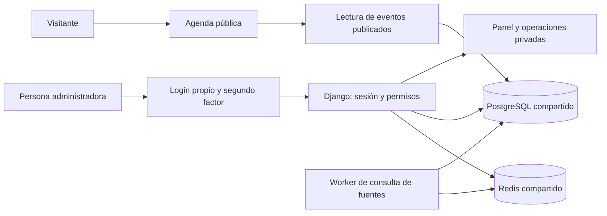

# Acceso propio y escalabilidad de Galicia Tech

Propuesta anterior sustituida por [Cuenta, acceso y configuración](cuenta-acceso-configuracion-2026-10-20.md). Se conserva como antecedente: el acceso ahora parte de Mi cuenta, los métodos sociales se consideran y Redis deja de ser un requisito inicial.

Fecha: 20 de octubre de 2026. Estado: diseño y propuesta técnica; no hay autenticación real implementada.

## Requisitos confirmados

- La aplicación debe funcionar independientemente del servidor de casa, de sus cuentas y de su sistema de acceso.
- Debe poder publicarse en Internet conservando sus cuentas, datos y reglas de acceso.
- La agenda y las fichas de eventos se pueden consultar sin cuenta. El panel de administración requiere credenciales en la versión funcional.
- Fuentes y Revisión son funciones privadas de gestión. Los enlaces de procedencia de cada evento siguen siendo públicos.
- El diseño debe prever crecimiento y permisos para más personas, aunque inicialmente solo haya una persona propietaria.
- Ahora se implementa el mock y se planifica la arquitectura; no se instala un servidor de identidad ni se conectan credenciales reales.

## Propuesta recomendada

Aplicación Django con autenticación local, django-allauth para el recorrido de acceso y MFA, y PostgreSQL desde el primer backend funcional. Redis compartido para límites de intentos y los trabajos en segundo plano. La aplicación será la propietaria de las identidades; estas no se obtendrán de cabeceras de un proxy doméstico.

Es una propuesta de stack, pendiente de implementar. Encaja con el colector Python existente y permite reutilizar las pantallas actuales como vistas propias. Elegir este backend no obliga a usar la interfaz visual del admin estándar de Django.

Django aporta usuarios, grupos, permisos y sesiones. django-allauth aporta recorridos de cuenta y extensiones para TOTP, códigos de recuperación y WebAuthn/passkeys. Activar y exigir MFA requiere configuración y verificación; instalar el paquete no hace privada una aplicación automáticamente. [Autenticación y permisos de Django](https://docs.djangoproject.com/en/5.2/topics/auth/default/), [MFA de django-allauth](https://docs.allauth.org/en/latest/mfa/introduction.html).

### Alternativas valoradas

| Opción | Encaje | Decisión propuesta |
| --- | --- | --- |
| Django + django-allauth, cuentas propias | Identidad y permisos dentro del producto; sin servicio externo de identidad obligatorio. | Base recomendada. |
| Keycloak o Authentik incluido en el despliegue del producto | Útil si varios productos necesitan compartir identidad, aplicaciones de terceros o federación. Añade otro servicio que mantener. | Posible evolución; no es requisito para escalar las réplicas de esta aplicación. |
| Authelia o forward-auth del servidor doméstico | Protege aplicaciones mediante infraestructura del alojamiento. | No será la dependencia de acceso del producto, por el requisito de independencia. |
| Apereo CAS | Servidor de identidad y SSO; puede integrarse mediante OIDC. | Integración opcional si aparece una necesidad concreta de SSO. |
| CASL | Biblioteca JavaScript de autorización: expresa qué puede hacer una persona con cada recurso. | No resuelve cuentas, contraseñas, sesiones o MFA. No se necesita para el backend Django propuesto. |

Estas decisiones son una valoración para este producto. [CASL](https://github.com/stalniy/casl) se presenta como biblioteca de autorización; [Apereo CAS](https://apereo.github.io/cas/7.3.x/protocol/OIDC-Protocol.html) documenta sus funciones OIDC; [Authentik](https://docs.goauthentik.io/add-secure-apps/providers/) distingue sus proveedores de identidad y proxy. Si en el futuro se utiliza CASL en una interfaz JavaScript, sus reglas visuales deberán reflejar las comprobaciones del servidor.

## Separación de responsabilidades

Una base de código modular y procesos separados para web y consultas. La identidad queda en el módulo de cuentas; fuentes, eventos y revisión tendrán servicios propios. Un dominio u origen común para interfaz y backend simplifica las sesiones del navegador. El proxy termina HTTPS y enruta tráfico; la aplicación sigue comprobando permisos incluso si se accede directamente a su backend.

Las consultas LLM serán trabajos del servidor. No recibirán contraseñas ni sesiones humanas y no podrán conceder permisos o modificar las reglas de identidad a través del contenido de una fuente. Sus escrituras se atribuirán a una identidad de servicio con permisos acotados.

## Identidades y permisos previstos

Crear un modelo de usuario propio desde la primera migración, basado en las utilidades de Django, con identificador estable, usuario único, estado activo y fechas de creación. La contraseña se gestiona con los hashers del framework; se propone Argon2id, ajustado a la capacidad del servidor y comprobado bajo carga. No se desarrollará un algoritmo propio. [Gestión de contraseñas de Django](https://docs.djangoproject.com/en/5.2/topics/auth/passwords/).

La primera persona propietaria se aprovisionará mediante un comando administrativo ejecutado en el servidor. No habrá contraseña por defecto, secreto en el repositorio ni endpoint público de «primer usuario = administrador». El registro público estará deshabilitado también en el backend. allauth permite cerrar las altas mediante su adaptador de cuentas. [Adaptadores de allauth](https://docs.allauth.org/en/latest/account/advanced.html).

Propuesta de roles, expresados con permisos del servidor:

| Capacidad | Visitante | Revisor | Editor | Propietario |
| --- | --- | --- | --- | --- |
| Consultar eventos publicados y sus fuentes | Sí | Sí | Sí | Sí |
| Ver evidencia y resolver revisiones | No | Sí | Sí | Sí |
| Crear, editar y pausar fuentes | No | No | Sí | Sí |
| Gestionar cuentas y asignar permisos | No | No | No | Sí |
| Cambiar ajustes de lectura y credenciales de servicios | No | No | No | Sí |

Inicialmente solo se creará el propietario. Los demás roles son capacidad prevista, no cuentas o pantallas añadidas al mock. Un usuario autenticado sin permiso de gestión no se convierte en administrador. La aplicación no confiará en un rol enviado por el navegador ni en una marca de localStorage.

## Flujo funcional propuesto

1. Una URL privada sin sesión redirige al login con un destino local validado. Las APIs devuelven 401; no redirigen a HTML.
2. El POST del login comprueba credenciales y límites de intentos. Un fallo muestra un mensaje genérico, sin revelar si existe el usuario.
3. Si falta MFA, se abre un estado temporal de verificación, sin autorización para consultar o modificar el panel. Para las cuentas de gestión expuestas en Internet se propone exigir MFA desde la primera publicación.
4. Al completar el segundo factor se rota la sesión y se accede al destino permitido. No se ejecuta automáticamente una escritura que hubiera quedado pendiente antes del login.
5. Cada petición privada comprueba usuario activo, sesión completa y permiso específico. Si tiene sesión pero no permiso, la API devuelve 403.
6. Cerrar sesión es un POST protegido contra CSRF; invalida la sesión en el servidor. Cambiar contraseña, retirar permisos, desactivar una cuenta o recuperar el acceso debe cortar los accesos afectados.

La ruta propuesta para la interfaz propia es `/gestion/`, con `/cuenta/entrar/` para el acceso y `/api/admin/…` para las operaciones privadas. La interfaz interna estándar de Django, si se habilita, deberá tener la misma política de acceso y MFA, evitando una segunda puerta de entrada sin esos controles. Los límites del login de allauth no protegen automáticamente el login estándar de Django. [Límites de allauth](https://docs.allauth.org/en/latest/account/rate_limits.html).

## Sesiones, recuperación y controles

Sesiones revocables en el servidor, inicialmente en PostgreSQL. La cookie transportará únicamente el identificador, con Secure, HttpOnly y SameSite, sobre HTTPS. No se guardarán tokens de acceso en localStorage. Añadir protección CSRF a todos los cambios, incluido el login, logout y operaciones de revisión. SameSite es una defensa adicional, no reemplaza CSRF. [Sesiones de Django](https://docs.djangoproject.com/en/5.2/topics/http/sessions/), [gestión de sesiones de OWASP](https://cheatsheetseries.owasp.org/cheatsheets/Session_Management_Cheat_Sheet.html).

Propuesta inicial de expiración: 30 minutos de inactividad y 8 horas de duración máxima, configurable. La inactividad requiere implementarse y probarse explícitamente. No habrá «recordarme» indefinido para administración. Pedir reautenticación antes de cambiar permisos, quitar MFA o modificar ajustes sensibles.

Aplicar límites por cuenta e IP al login, OTP y recuperación, con estado compartido en Redis y comportamiento probado ante concurrencia. La identidad de IP se tomará exclusivamente de los proxies configurados como fiables. Configurar los límites de allauth y sus vistas relacionadas; no basta con mostrar un contador en el navegador. [Límites de allauth](https://docs.allauth.org/en/latest/account/rate_limits.html), [autenticación de OWASP](https://cheatsheetseries.owasp.org/cheatsheets/Authentication_Cheat_Sheet.html).

Para comenzar: TOTP y códigos de recuperación de un solo uso. El aprovisionamiento del propietario incluirá un correo principal verificado mediante un canal confiable, coherente con los requisitos de activación MFA de allauth. Se propone cifrar los secretos TOTP con una clave de despliegue separada de la base de datos y documentar su rotación. La recuperación administrativa desde el servidor será una alternativa documentada para el propietario; no requiere un proveedor de identidad doméstico. Si se configura correo, se podrá ofrecer recuperación por enlace temporal sin revelar la existencia de la cuenta. Restablecer solo la contraseña no debe saltarse un segundo factor todavía activo. Cada recuperación debe registrarse y revocar las sesiones pertinentes.

Passkeys queda como extensión, una vez definido el dominio de producción. Las credenciales WebAuthn se vinculan al RP ID; cambiarlo puede requerir registrar credenciales de nuevo, por lo que no se promete trasladarlas automáticamente entre un host doméstico y otro público. [Estándar WebAuthn](https://www.w3.org/TR/webauthn-3/).

Registrar quién cambió una fuente, publicó o descartó una revisión, modificó permisos o restableció el acceso. Los registros no contendrán contraseñas, OTP, cookies ni códigos de recuperación. Las copias de seguridad deberán cubrir datos y las claves necesarias para restaurar MFA; probar esa restauración forma parte del despliegue funcional.

## Crecimiento y portabilidad

- PostgreSQL desde el primer backend real: usuarios, permisos, eventos, revisiones, sesiones y auditoría con migraciones versionadas.
- Varias instancias web comparten sesiones y permisos; no dependen de archivos o memoria local de una réplica. Se puede añadir `cached_db` con Redis manteniendo PostgreSQL como respaldo. [Motores de sesiones](https://docs.djangoproject.com/en/5.2/topics/http/sessions/).
- Redis conserva el estado compartido de límites y la cola. Los trabajos se ejecutan fuera de las peticiones web, con tareas idempotentes y una programación coordinada para evitar lecturas duplicadas.
- La agenda pública puede usar caché y CDN; las respuestas de cuenta, sesión y gestión no se cachean públicamente.
- Distribución prevista en contenedores con configuración de dominio, HTTPS, conexiones y secretos por entorno. Cambiar de servidor requiere migrar datos y configuración, sin rediseñar el login. Si cambia el dominio, se iniciarán sesiones nuevas.
- Para recuperar un despliegue o moverlo, probar restauración y cambio de secretos. No considerar una copia de HTML estático como una publicación funcional segura.

## Qué se ha diseñado en el mock

`login.html` mantiene Material Expressive y ambos temas. La entrada «Administración» de Agenda y de las fichas lleva al login. El recorrido de muestra permite continuar hasta un segundo factor y después al panel, sin comprobar lo escrito. Incluye estados visuales de error genérico, sesión caducada, recuperación y código de respaldo. «Salir de la demo» vuelve al acceso y conserva las preferencias de fuentes y revisión.

El formulario no lee, envía ni guarda credenciales; limpia los campos al avanzar. No utiliza cookies de autenticación ni una marca de sesión en localStorage. Los campos no tienen `name` y los botones permanecen desactivados sin JavaScript. Los destinos están limitados a las tres pantallas del panel. Las URLs privadas siguen abiertas deliberadamente en esta muestra: no existe protección real.

## Validación realizada del diseño

Se comprobó en Chrome el recorrido completo y los estados de error, caducidad, recuperación y código de respaldo; los destinos del panel y el rechazo de destinos externos; la ausencia de solicitudes con los datos introducidos y de marcas de autenticación en almacenamiento; la limpieza de campos al avanzar; los botones desactivados sin JavaScript; y la adaptación de los estados a ambos temas en anchos de 320, 390, 621, 850 y 1280 px. También se comprobó la navegación de salida de las tres pantallas de gestión. Esto valida la interacción del prototipo, no las garantías del futuro servidor.

## Criterios antes de una publicación funcional

1. Abrir el panel o su API directamente sin sesión no permite leer datos privados ni escribir.
2. Modificar, pausar o publicar sin permiso devuelve rechazo, aunque se construya manualmente la petición.
3. Completar solo la contraseña no autoriza una cuenta que requiere MFA; OTP y recuperación no admiten reutilización.
4. Logout, cambio de contraseña y retirada de permisos bloquean las sesiones correspondientes, incluso entre réplicas.
5. Destinos externos en `next`, CSRF inválido y peticiones no autorizadas no producen cambios.
6. Login, OTP y recuperación mantienen sus límites al repartir peticiones entre instancias.
7. No se exponen credenciales o datos internos mediante HTML público, API pública, logs, caché o copias descargables.
8. Se conserva el funcionamiento tras restaurar PostgreSQL y los secretos de MFA en otro servidor.

Estos son criterios para la futura implementación; no están validados por el mock estático. Las versiones concretas de Django y allauth se fijarán y probarán al construir el backend, tomando ramas mantenidas y compatibles en ese momento.
